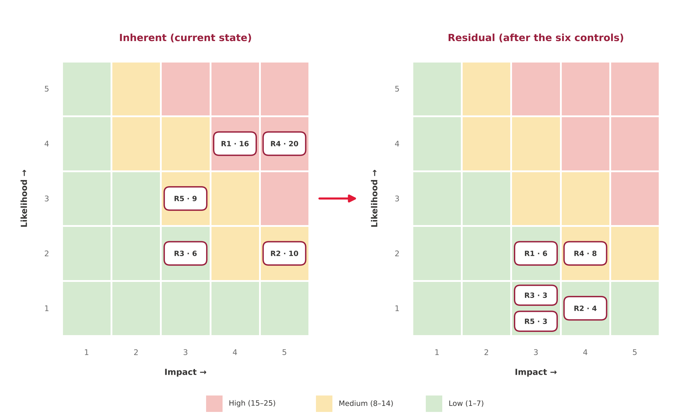

# Security Management Plan – PharmUniverse (case study)

An ISO/IEC 27001:2022-aligned Security Management Plan for **PharmUniverse**, a fictional multinational pharmaceutical manufacturer. Version 2.0 is written as a working GRC deliverable: prepared by a GRC analyst for the CISO and submitted to the Executive Committee for approval.

> **Fictional organisation.** PharmUniverse is not a real company. The scenario is adapted from an ISACA caselet (*McClintock Manufacturing – Using COBIT® 5 for Information Security*, © 2013 ISACA). The caselet itself is not reproduced here.

**[Read the plan (PDF)](Security_Management_Plan_PharmUniverse.pdf)** · editable source: [`source/Security_Management_Plan_PharmUniverse.docx`](source/Security_Management_Plan_PharmUniverse.docx) · risk model: [`analysis/`](analysis/)

## The scenario

PharmUniverse is a publicly listed pharmaceutical manufacturer headquartered in London, with branches in Hanover, Barcelona, Singapore, Hong Kong and St. Louis, about 9,000 employees and £201m revenue (2022). Its business units share manufacturing machinery that must be available 24/7 and is run by process-automation software. The network is flat, files move by FTP, and the security function has little influence with a CEO-led board and siloed business units. The task: identify critical information assets and risks, select and justify controls, and plan an ISMS that the organisation can actually adopt.

## Headline results

- Five risks to two critical assets, assessed with CVSS v3.1 (full vectors), likelihood × impact and annualised loss expectancy (ALE).
- Expected annual loss of about **£6.35m** before treatment, 42% of annual profit. Two risks are High: ransomware spreading into manufacturing and unauthorised access through compromised credentials.
- Six controls mapped to ISO/IEC 27001:2022 Annex A cut expected annual loss by **78%** to about **£1.38m** and leave no High risks, for £1.525m one-off and £1.1m a year.
- Certification roadmap of 15 months, with the Stage 2 audit in month 14.



## What's inside

| Part | Contents |
| --- | --- |
| Section 1 | Executive summary: findings, recommendation, investment case and decisions requested |
| Sections 2–4 | Background; current-state findings and target network architecture; ISMS scope, interested parties, legal and regulatory register, assurance frameworks |
| Section 5 | ISMS: certification roadmap, budget, risk method and appetite, risk treatment and Statement of Applicability, KPIs and KRIs, internal audit and management review, security testing, continual improvement |
| Sections 6–10 | Policy hierarchy, governance and RACI, incident management and continuity, supplier security, people security, asset management, access control |
| Appendix 1 | Critical information assets: R&D data; CAD/CAM, production and process-control systems |
| Appendix 2 | Five risk scenarios with CVSS v3.1 vectors, ALE workings, prioritisation and C-I-A trade-offs |
| Appendix 3 | Six controls: Annex A mapping, ISO/IEC 27002 attributes, implementation, audit approach and secondary risks |
| Appendix 4 | Effectiveness: qualitative assessment of three controls; cost-benefit analysis (ROSI, break-even) of three; a rejected option; sensitivity analysis; combined residual risk |
| Appendix 5 | Top-level information security policy, topic-specific policy framework, embedding, ethical and legal considerations |
| Appendix 6 | Case-specific barriers, mitigations, trade-offs and alternatives considered |
| Appendix 7 | Statement of Applicability (extract) |

## Skills demonstrated

- ISMS planning to ISO/IEC 27001:2022: scope, interested parties, risk criteria and appetite, Statement of Applicability, internal audit, management review and a certification roadmap
- Risk assessment combining CVSS v3.1 environmental scoring, likelihood × impact scales and annualised loss expectancy
- Cost-benefit analysis of controls (ALE, ROSI, break-even, sensitivity) and budget planning
- Control design mapped to Annex A (2022) and ISO/IEC 27002 attributes, with audit tests, sampling and secondary risks
- Governance design: steering committee, RACI, board reporting and a redesigned KPI/KRI set
- Regulatory mapping for a multinational pharmaceutical manufacturer: UK and EU GDPR, NIS2, UK Corporate Governance Code 2024, EU GMP Annex 11, 21 CFR Part 11 and works-council co-determination
- OT security architecture (IEC 62443 zones and conduits) and policy writing

## Frameworks and standards

ISO/IEC 27001:2022 (including Amd 1:2024), ISO/IEC 27002:2022, ISO/IEC 27005:2022, CVSS v3.1, NIST Cybersecurity Framework 2.0, NIST SP 800-82 Rev. 3, IEC 62443, NIST SP 800-55, GAMP 5, EU GMP Annex 11, 21 CFR Part 11, UK and EU GDPR, NIS2 and the UK Corporate Governance Code 2024.

## Reproducing the numbers

Every risk, control and cost figure in the plan comes from one model, so the numbers can be checked and re-run with different assumptions:

```bash
cd analysis
pip install -r requirements.txt
python risk_model.py   # recalculates CVSS scores, ALE, cost-benefit and residual risk into model.json
python figures.py      # redraws the plan's figures into figures/
```

## Versions

| Version | Date | Notes |
| --- | --- | --- |
| 2.0 | Nov 2026 | Redrafted as a working GRC deliverable and aligned to ISO/IEC 27001:2022. Rebuilt risk model with reproducible CVSS vectors and ALE; cost-benefit and sensitivity analysis; controls revised; added executive summary, legal register, governance, roadmap and budget, audit approach, metrics redesign, policy framework and Statement of Applicability extract |
| 1.1 | Nov 2026 | Prepared for publication: formatting, metadata and figures cleaned up; analysis unchanged |
| 1.0 | Dec 2023 | Original plan, written as part of my MSc studies (ISO/IEC 27001:2013) |

## Limitations

- PharmUniverse is fictional. Figures are planning estimates built from the caselet's 2022 financials plus stated assumptions, such as a 40% gross margin and about 1,200 R&D and design users.
- Frequencies and losses are point estimates; a next iteration would use ranges and Monte Carlo simulation.
- CVSS is designed for vulnerabilities; applying it to risk scenarios scores the representative attack path, which is a simplification.
- Legal and regulatory points are a GRC analyst's register for Legal to validate, not legal advice. Legislative status is as at November 2026.

## How it was made

Written in 2023 as postgraduate coursework and revised for publication in 2026. While writing the original version I used ChatGPT to summarise source material and clarify the task requirements, then reviewed and edited the content myself. The 2026 publication clean-up (formatting and redrawn figures) was also AI-assisted. Version 2.0 was redrafted with substantial help from an AI assistant (Claude, by Anthropic), working from my original plan, the case study and my instructions: it rebuilt the risk model and figures and drafted most of the new text, and I reviewed the analysis, assumptions and sources.

## Repository structure

```
.
├── README.md
├── Security_Management_Plan_PharmUniverse.pdf   ← start here
├── source/
│   └── Security_Management_Plan_PharmUniverse.docx
└── analysis/
    ├── README.md
    ├── requirements.txt
    ├── risk_model.py      ← single source of truth for every figure
    ├── model.json
    ├── figures.py
    └── figures/
```

## Disclaimer and reuse

This is an educational case study. PharmUniverse, its figures, risks and controls are fictional or illustrative and describe no real organisation. Not affiliated with or endorsed by ISACA. Shared for portfolio purposes: please don't submit it, in whole or in part, as your own coursework.
